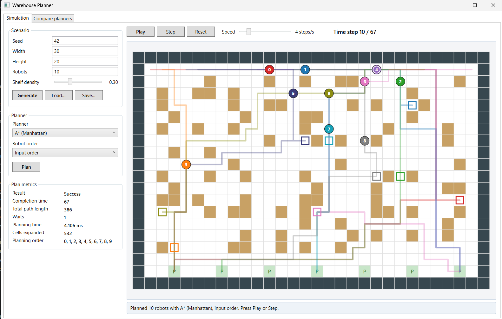

# Multi-Agent Warehouse Planning Simulator

[](https://github.com/Haripratapvarma/multi-agent-warehouse-planner/actions/workflows/ci.yml)

Robots in a grid warehouse each drive from a start cell to a pickup cell next
to a shelf, then to a packing station, without ever colliding. A C++ engine
plans the routes with A* search over space and time; a WPF desktop app lets
you set up scenarios, watch the robots move step by step, and compare
planners over many seeded runs.



## Features

- **Grid warehouse** with walls, shelves and packing stations, built by a
  seeded generator: the same seed and settings always give the same scenario.
  Scenarios can be saved and loaded as small text files (examples in
  `Engine/scenarios/`, including a narrow corridor where a robot must wait).
- **Single-robot search**: A* with the Manhattan distance heuristic, and BFS
  as a reference.
- **Multi-robot planning**: prioritized planning ("cooperative A*") over
  (cell, time) with a reservation table that blocks shared cells and head-on
  swaps.
- **Three planners** with the same collision rules (A* with Manhattan
  distance, A* with true distance, BFS) and **two robot orderings** (input
  order, longest task first).
- **Plan validator** that independently checks any plan step by step.
- **Metrics**: completion time (makespan), total path length, waits, planning
  time, cells expanded, success.
- **C interface DLL** used from C# through `LibraryImport` and `SafeHandle`.
- **WPF app** (MVVM): generate, plan, play / pause / step / reset with a
  speed slider, load / save scenarios, and a *Compare planners* tab that runs
  many seeds on background threads with progress, cancel and CSV export.
- **Tests**: native tests registered with CTest, xUnit tests for the interop
  layer and the view models, and CI on Windows and Linux (including
  AddressSanitizer and UndefinedBehaviorSanitizer).

## Repository layout

```
Engine/                     C++ engine (CMake)
  include/warehouse/        public headers, including the C interface c_api.h
  src/                      grid, generator, search, reservation table, planner, validator, C interface
  tests/                    native tests (small self-written test helper, run by CTest)
  tools/                    wh_demo and wh_bench command-line programs
  scenarios/                example scenario files
src/
  Warehouse.Interop/        C# wrapper around the DLL (P/Invoke, SafeHandles)
  Warehouse.ViewModels/     screen logic, no WPF types
  Warehouse.Desktop/        WPF app
tests/
  Warehouse.Interop.Tests/      xUnit: interop round trips, struct sizes, errors, memory
  Warehouse.ViewModels.Tests/   xUnit: view models with a fake engine
docs/                       architecture, design decisions, benchmark results
```

## Building and running

Requirements: a C++ compiler with CMake (on Windows, Visual Studio Build Tools
with the C++ workload), and the .NET 10 SDK.

### Engine (C++)

In VS Code with the CMake Tools extension, open the repository folder;
`.vscode/settings.json` points CMake at `Engine/`. Build, then run the tests
with CTest. All programs and the DLL are written to `Engine/build/bin`.

From a terminal:

```
cmake -S Engine -B Engine/build
cmake --build Engine/build --config Release
ctest --test-dir Engine/build -C Release
```

### C# libraries, tests and the desktop app

Build the engine first: the C# build copies `warehouse_engine.dll`
(`libwarehouse_engine.so` on Linux) from `Engine/build/bin` next to every
program that uses it.

```
dotnet test                                   # all C# projects and tests
dotnet run --project src/Warehouse.Desktop    # the desktop app (Windows)
```

`Warehouse.CrossPlatform.slnf` contains everything except the Windows-only
desktop app, so the libraries and their tests also build and run on Linux:

```
dotnet test Warehouse.CrossPlatform.slnf
```

### Command-line tools

```
Engine/build/bin/wh_demo --seed 42 --size 20x10 --robots 4 --density 0.3
Engine/build/bin/wh_demo --load Engine/scenarios/narrow_corridor.txt --show-steps
Engine/build/bin/wh_bench --seeds 100 --robots 10 --size 30x20 --csv results.csv
```

`wh_demo` prints a scenario, compares single-robot A* with BFS, then plans all
robots together and can print the grid at every time step. `wh_bench` runs
every planner with both orderings on many seeds and prints a comparison table.

## How the planner works

Each robot has two legs: start → pickup cell, then pickup → packing station.
A robot moves up, down, left or right, or waits, once per time step, and
leaves the grid when it delivers.

1. **Single robot**: A* explores cells in order of *f = g + h*, where *g* is
   the number of moves so far and *h* is an estimate of the moves still
   needed. The Manhattan distance |dx| + |dy| never overestimates on a grid
   where every move costs 1, so the first path A* finds is a shortest one.
2. **Many robots**: robots are planned one at a time in a priority order.
   The search runs over *(cell, time)* states and may also wait. Every
   planned route is written into a **reservation table**:
   - *(cell, t)* entries stop two robots being in one cell at the same time;
   - *(from, to, t)* entries stop a **head-on swap**, where two robots trade
     cells between t and t + 1 and would pass through each other.

   Later robots treat reservations as obstacles. Every robot's start cell is
   reserved at t = 0, and a time limit (width × height × 4 steps) guarantees
   a search always ends with either a route or a "no path" result.
3. **Planners** differ only in the estimate *h*: Manhattan distance, the true
   distance from a backward BFS that ignores other robots, or none (BFS).
4. **Validator**: a separate function replays any plan and checks for shared
   cells, swaps, illegal moves and pickup-before-station. The tests and
   `wh_bench` run every successful plan through it.

More detail in [docs/architecture.md](docs/architecture.md) and
[docs/design-decisions.md](docs/design-decisions.md).

## Results

Measured with `wh_bench` on a 13th Gen Intel Core i7-13620H (Windows 11,
Release build, plans run one after another on one thread). Seeds 1–100 for
each configuration. Success rate is over all 100 seeds; the other columns are
averages over the seeds where every planner and ordering succeeded, so all
rows describe the same scenarios. Path length is the total number of steps of
all robots, waits included. Raw output: [docs/results](docs/results).

**30 × 20 grid, 10 robots, shelf density 0.3** (averages over 95 seeds)

| Planner | Ordering | Success | Completion time | Path length | Waits | Runtime (ms) | Cells expanded |
|---|---|---:|---:|---:|---:|---:|---:|
| A* (Manhattan) | Input order | 97% | 53.3 | 364.0 | 1.3 | 0.481 | 629 |
| A* (Manhattan) | Longest first | 98% | 52.7 | 363.5 | 0.9 | 0.710 | 593 |
| A* (true distance) | Input order | 96% | 53.3 | 364.0 | 1.3 | 0.835 | 428 |
| A* (true distance) | Longest first | 97% | 52.7 | 363.7 | 0.8 | 1.105 | 417 |
| BFS (no heuristic) | Input order | 96% | 53.3 | 364.0 | 1.2 | 15.437 | 37,040 |
| BFS (no heuristic) | Longest first | 97% | 52.7 | 363.7 | 0.8 | 15.488 | 36,688 |

**40 × 30 grid, 20 robots, shelf density 0.4** (averages over 72 seeds)

| Planner | Ordering | Success | Completion time | Path length | Waits | Runtime (ms) | Cells expanded |
|---|---|---:|---:|---:|---:|---:|---:|
| A* (Manhattan) | Input order | 91% | 82.8 | 1065.6 | 4.1 | 1.640 | 2,618 |
| A* (Manhattan) | Longest first | 90% | 81.0 | 1062.8 | 3.0 | 2.408 | 2,242 |
| A* (true distance) | Input order | 89% | 82.9 | 1066.3 | 3.8 | 2.726 | 1,373 |
| A* (true distance) | Longest first | 86% | 81.0 | 1063.2 | 2.8 | 3.722 | 1,306 |
| BFS (no heuristic) | Input order | 87% | 82.9 | 1066.5 | 3.6 | 85.755 | 216,363 |
| BFS (no heuristic) | Longest first | 83% | 81.0 | 1063.2 | 2.5 | 85.308 | 213,946 |

What the numbers show:

- **Heuristics matter for effort, not route quality.** All three planners
  find routes of the same length per leg (each search is optimal given the
  reservations), but BFS expands 58–166 times more cells than the A*
  planners and is 14–52 times slower.
- **True distance expands the fewest cells but is not the fastest**: it
  builds a distance map with a backward BFS for every leg, and on these grid
  sizes that cost outweighs the saved expansions.
- **Longest task first** gives slightly shorter completion times and fewer
  waits. Its planning time includes computing every robot's task length
  first.
- **Success rates differ between planners** even though each leg is
  optimal: when several routes are equally short, the planners can pick
  different ones, which changes the reservations later robots see. This is
  the order sensitivity of prioritized planning.

## Known limitations

- **Prioritized planning is not complete or globally optimal.** Robots are
  planned one at a time, so an early robot can box in a later one (2–17 % of
  runs above fail this way) and the total plan can be longer than necessary.
  **Conflict-Based Search (CBS)** plans all robots jointly and finds an
  optimal collision-free plan, at a much higher worst-case cost; it is not
  implemented here.
- The two legs are planned one after the other: the earliest arrival at the
  pickup is chosen even if a later one would make the second leg shorter.
- Robots leave the grid when they deliver; they do not park or start new
  tasks.
- Movement is idealised: 4-connected grid, one cell per step, no turning time
  or acceleration.
- Runtimes depend on the machine. The *Compare planners* tab runs several
  plans at once by default; set *Threads* to 1 for timings comparable to
  `wh_bench`.
- Grids are limited to 100 × 100 cells.
